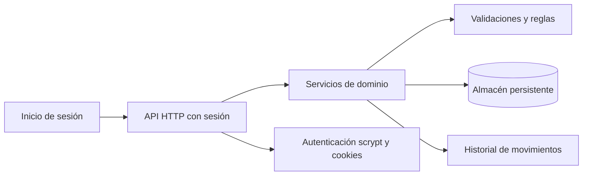
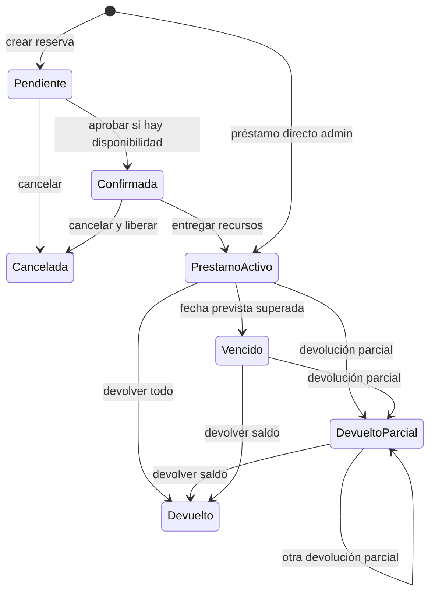

# Arquitectura del sistema de mobiliario

## 1. Arquitectura general

MVP ejecutable con Node.js sin dependencias externas. El navegador consume una API HTTP protegida por sesión; los servicios de dominio validan cada operación y actualizan un almacén JSON persistente. El servidor serializa las escrituras para que dos solicitudes no descuenten el mismo recurso ni el saldo de una billetera.



El JSON es apropiado para la demostración local de un único proceso, no para desplegar múltiples instancias. En producción, se conserva el límite API/servicio y se migra a PostgreSQL; las modificaciones de inventario, estados y auditoría deben ejecutarse en una misma transacción con bloqueo o control de concurrencia.

## 2. Entidades y relaciones

- **Usuario** (`id`, `nombre`, `correo`, `rol`): crea reservas y préstamos; rol `admin` o `usuario`.
- **Acceso de demostración** (`passwordHash`): una sola cuenta autorizada, con contraseña derivada mediante scrypt y sal individual; no hay registro público.
- **Sesión** (`tokenHash`, `userId`, `expiresAt`): token aleatorio guardado como hash y entregado en cookie `HttpOnly`, `SameSite=Strict`, con duración de siete días.
- **Movimiento de billetera** (`id`, `tipo`, `centavos`, `remitenteId`, `destinatarioId`, `creadoEn`): libro mayor de recargas ficticias y transferencias internas.
- **Recurso** (`id`, `nombre`, `total`): catálogo pequeño, inicializado con mesas y sillas.
- **Reserva** (`id`, `usuarioId`, `fecha`, `horaInicio`, `horaFin`, `cantidades`, `estado`, `creadaEn`): pertenece a un usuario. Estados: pendiente, confirmada, cancelada, finalizada.
- **Préstamo** (`id`, `usuarioId`, `reservaId?`, `fechaPrestamo`, `fechaPrevistaDevolucion`, `cantidadesIniciales`, `cantidadesDevueltas`, `estado`, `observaciones`): puede nacer de una reserva confirmada o de un préstamo administrativo directo.
- **Devolución** (`id`, `prestamoId`, `cantidades`, `fechaReal`, `observaciones`): un préstamo admite varias devoluciones parciales.
- **Movimiento** (`id`, `usuarioId`, `tipo`, `entidadId`, `cantidades`, `fecha`, `estadoAnterior`, `estadoPosterior`): registro de auditoría append-only.

Las relaciones serían claves foráneas: reserva → usuario; préstamo → usuario y, opcionalmente, reserva; devolución → préstamo; movimiento → actor y entidad de origen.

El inventario se deriva, no mantiene contadores editables independientes:

- `reservadas`: cantidades de reservas pendientes o confirmadas todavía no convertidas en préstamo.
- `prestadas`: cantidades iniciales del préstamo menos las devoluciones acumuladas.
- `disponibles`: `total - reservadas - prestadas`.
- `devueltas`: cantidades devueltas acumuladas; es un dato de flujo, no se suma al total.
- El saldo monetario se deriva del libro mayor en centavos: recargas y transferencias recibidas se suman; las transferencias enviadas se restan.

La billetera es únicamente una simulación local: no tiene depósitos, cobros ni conexión con bancos o redes de pago. Una recarga de demostración crea saldo ficticio. Cada transferencia comprueba y actualiza ambos lados en una única escritura serializada.

## 3. Flujo de operaciones



Al pasar de reserva confirmada a préstamo, la cantidad deja de contarse como reservada y pasa a prestada en una sola operación; no cambia el total ni queda disponible durante la transición. Cada devolución parcial aumenta disponibilidad solo por lo recibido.

## 4. API

- `GET /api/dashboard`: indicadores e inventario calculado.
- `GET /api/inventory`: totales y cantidades derivadas.
- `PATCH /api/inventory/:resourceId`: ajuste administrativo del total, nunca por debajo de lo comprometido.
- `GET|POST /api/reservations`: listar/crear reserva.
- `PATCH /api/reservations/:id`: confirmar o cancelar.
- `GET|POST /api/loans`: listar/crear préstamo directo.
- `POST /api/reservations/:id/loan`: convertir reserva confirmada en préstamo.
- `POST /api/loans/:id/returns`: registrar devolución total o parcial.
- `GET /api/history`: consultar movimientos.
- `GET /api/users`: consultar usuarios de la demo.
- `POST /api/auth/login`, `GET /api/auth/session`, `POST /api/auth/logout`: iniciar, consultar y cerrar la sesión única.
- `GET /api/wallet`: consultar saldo e historial personal.
- `POST /api/wallet/deposits`: añadir saldo ficticio de prueba.
- `POST /api/wallet/transfers`: transferir saldo a otra cuenta registrada.

Las mutaciones responden con el registro actualizado y el inventario nuevo; errores de validación usan HTTP 400/404/409 con un mensaje legible.

## 5. Roles y permisos

- **Administrador:** ajustar inventario; confirmar/cancelar reservas; registrar préstamos directos, entregas y devoluciones; consultar todos los registros e historial.
- **Usuario:** consultar disponibilidad; crear, consultar y cancelar sus reservas pendientes/confirmadas; consultar sus préstamos.

La aplicación permite iniciar sesión únicamente con la cuenta de demostración de Jeffrey Diddy. No ofrece registro de cuentas. El servidor deriva al actor de la sesión válida y protege todas las rutas API operativas.

## 6. Reglas de negocio

1. Ninguna cantidad puede ser negativa ni superar la disponibilidad al confirmar reserva o crear préstamo.
2. La suma de reservas confirmadas y saldos prestados nunca supera el total.
3. El préstamo originado por una reserva consume esa reserva una sola vez.
4. Una devolución no puede exceder el saldo pendiente de ninguna clase de recurso.
5. Fechas válidas: fin posterior a inicio; devolución prevista no anterior al préstamo.
6. El préstamo queda devuelto cuando todos los saldos llegan a cero; si no, queda parcialmente devuelto o vencido.
7. Cada cambio de estado/cantidad y su movimiento se persisten juntos; el historial no se edita desde la API.
8. Los totales solo pueden ajustarse si el nuevo total cubre reservas y préstamos pendientes.

## 7. Estructura de carpetas

```text
.
├── ARCHITECTURE.md
├── server.js                 # Arranque HTTP y rutas
├── src/
│   ├── store.js              # Lectura/escritura persistente y serializada
│   ├── inventory.js          # Proyecciones de inventario y dashboard
│   └── services.js           # Reglas de reservas, préstamos y devoluciones
├── data/
│   └── db.json               # Datos locales; inicialización automática
└── public/
    ├── index.html
    ├── app.js
    └── styles.css
```

La separación permite reemplazar el almacén por un adaptador SQL sin mezclar la presentación, la autenticación o las reglas de inventario. Para procesar pagos reales hace falta integrar un proveedor de pagos por separado; el saldo de demostración no representa dinero.